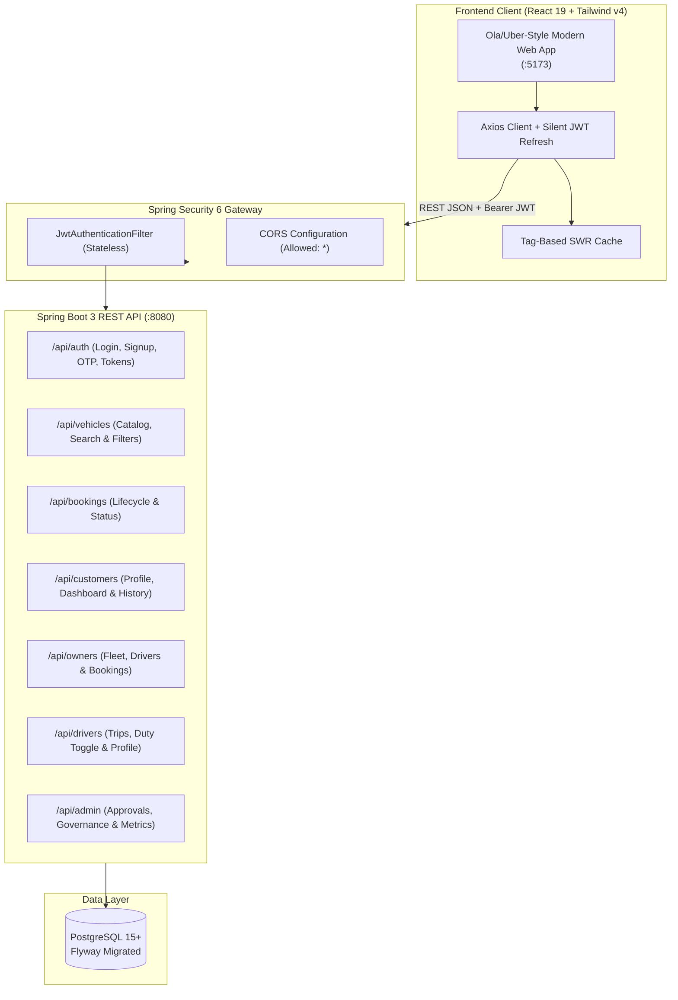

# 🚗 DriveEase — Full-Stack Car Rental & Cab Mobility Platform

[](https://www.oracle.com/java/)
[](https://spring.io/projects/spring-boot)
[](https://react.dev/)
[](https://tailwindcss.com/)
[](https://www.postgresql.org/)
[](LICENSE)

An enterprise-grade, full-stack vehicle rental and on-demand mobility platform inspired by the speed, simplicity, and polish of **Ola** and **Uber**. DriveEase bridges customers, fleet owners, professional drivers, and administrators into a cohesive ecosystem with transparent pricing, instant booking verification, and role-based operational dashboards.

---

## 🌿 Repository Structure & Git Branches

This repository is maintained with clean separation between Frontend and Backend:

| Branch | Purpose | Directory Path |
|---|---|---|
| **`main`** | Master branch containing Backend REST API, tests, schema migrations & root guide | `car_rental_application` |
| **`backend`** | Dedicated Spring Boot 3 Backend microservice | `car_rental_application` |
| **`frontend`** | Dedicated React 19 + Tailwind CSS v4 Client Application | `Car Rental Application` |

> [!TIP]
> You can checkout either component independently:
> ```bash
> # To clone and work on the Frontend only:
> git checkout frontend
> 
> # To work on the Backend only:
> git checkout backend
> ```

---

## 🏛️ System Architecture



---

## ✨ Features by Role

### 1. 👤 Customers (Ola / Uber Style Experience)
- **High-Impact Vehicle Showcase**: Interactive car hero slider, category pills (Sedan, Luxury, EV, 7-Seater, SUV).
- **Multi-Factor Search & Filter**: Real-time filtering by City, Seating Capacity, Fuel Type (Petrol, Diesel, EV), and Vehicle Type.
- **Transparent Pricing**: Clear ₹/km calculation, estimated daily rates, and free cancellation guarantee.
- **Instant Booking Itinerary**: Select pickup/drop locations, start/end dates, passenger count, and itinerary notes.
- **Trip-Start OTP & Tracking**: Secure trip-start OTP verification, assigned driver contact details, and cancellation workflows.

### 2. 🏢 Vehicle Owners (Fleet Management)
- **Fleet Portal**: Register vehicles with multi-angle photos, vehicle specs, and pricing per km.
- **Driver Allocation**: Assign verified drivers to customer booking requests or request replacements.
- **Booking Review**: Accept, reject, or track rental requests in real time.
- **Revenue Dashboard**: Track vehicle utilization, active leases, and earnings.

### 3. 🚖 Drivers (Operations & Trips)
- **Duty Availability**: 1-click toggle between **Active** (On-Duty) and **Inactive** (Off-Duty Rest).
- **Assigned Trip Queue**: Review trip pickup address, customer info, and itinerary details.
- **Trip Execution**: Transition ride states (`IN_PROGRESS`, `COMPLETED`) using customer trip verification OTPs.

### 4. 🛡️ Super Admin (Platform Governance)
- **Approval Engine**: Review and approve/reject pending vehicles, drivers, and owner registrations with feedback notes.
- **Account Lifecycle**: Activate, soft-delete, or restore user accounts.
- **Platform Analytics**: Total revenue, active drivers, total bookings, and pending queue metrics.

---

## 🚀 Quick Start Guide

### 📋 Prerequisites
- **Java**: OpenJDK 21 or Oracle JDK 21+
- **Maven**: 3.8+ (or use `./mvnw`)
- **Node.js**: 18.x or 20.x+
- **PostgreSQL**: 14+ running locally or in Docker

---

### 1. Backend Setup & Run

#### Step 1: Configure PostgreSQL Database
Create a PostgreSQL database named `car_rental_db2`:
```sql
CREATE DATABASE car_rental_db2;
```

#### Step 2: Configure `application.properties`
Review `src/main/resources/application.properties` (or set environment variables):
```properties
spring.datasource.url=jdbc:postgresql://localhost:5432/car_rental_db2
spring.datasource.username=postgres
spring.datasource.password=System

# JWT Security
app.jwt.secret=404E635266556A586E3272357538782F413F4428472B4B6250645367566B5970
app.jwt.access-token-expiration-ms=3600000
app.jwt.refresh-token-expiration-ms=604800000

# Server
server.port=8080
```

#### Step 3: Compile & Run Backend
```bash
cd "D:\Kalibytes\car rental\car_rental_application"
mvn clean spring-boot:run
```

The Spring Boot backend will start on **`http://localhost:8080`**.
- **Swagger / OpenAPI Documentation**: `http://localhost:8080/swagger-ui.html`
- **OpenAPI Schema JSON**: `http://localhost:8080/v3/api-docs`

---

### 2. Frontend Setup & Run

#### Step 1: Switch to Frontend Directory & Install Dependencies
```bash
cd "D:\Kalibytes\car rental\Car Rental Application"
npm install
```

#### Step 2: Configure Environment `.env`
Ensure `.env` points to the live backend:
```properties
VITE_API_BASE_URL=http://localhost:8080/api
VITE_USE_MOCK=false
```

#### Step 3: Start Vite Dev Server
```bash
npm run dev
```

Open your browser at:
👉 **`http://localhost:5173`**

---

## 🔑 Default Demo Accounts

The application includes seeded test users across all platform roles:

| Role | Email | Password |
|---|---|---|
| **Customer** | `customer@carrental.com` | `Password@123` |
| **Fleet Owner** | `owner@carrental.com` | `Password@123` |
| **Verified Driver** | `driver@carrental.com` | `Password@123` |
| **Super Admin** | `admin@carrental.com` | `Admin@123` |

---

## 📡 REST API Reference

All endpoints are prefixed with `/api` (and backward-compatible with `/api/v1`):

### 🔐 Authentication (`/api/auth`)
| Method | Endpoint | Description | Access |
|---|---|---|---|
| `POST` | `/api/auth/customer/signup` | Register new customer account | Public |
| `POST` | `/api/auth/owner/signup` | Register new vehicle owner account | Public |
| `POST` | `/api/auth/login` | User login (returns Access & Refresh JWT) | Public |
| `POST` | `/api/auth/admin/login` | Administrator login | Public |
| `POST` | `/api/auth/refresh-token` | Obtain new access token via refresh token | Public |
| `POST` | `/api/auth/verify-email` | Verify registration OTP code | Public |
| `POST` | `/api/auth/resend-verification-otp` | Resend 6-digit email OTP | Public |
| `POST` | `/api/auth/forgot-password` | Request password reset instructions | Public |
| `POST` | `/api/auth/reset-password` | Reset password using valid reset token | Public |
| `GET` | `/api/auth/me` | Fetch active user profile from JWT | Authenticated |
| `POST` | `/api/auth/logout` | Terminate session & invalidate token | Authenticated |

### 🚙 Vehicle Discovery & Management (`/api/vehicles`)
| Method | Endpoint | Description | Access |
|---|---|---|---|
| `GET` | `/api/vehicles` | Search available vehicles with filters (`city`, `vehicleType`, `seatingCapacity`) | Public |
| `GET` | `/api/vehicles/{id}` | Get vehicle details by ID | Public |
| `GET` | `/api/vehicles/my-vehicles` | Get current owner's listed fleet | `ROLE_OWNER` |
| `POST` | `/api/vehicles` | List a new vehicle for approval | `ROLE_OWNER` |
| `PUT` | `/api/vehicles/{id}` | Update vehicle specifications | `ROLE_OWNER` |
| `DELETE` | `/api/vehicles/{id}` | Delete / soft-delete vehicle | `ROLE_OWNER` |

### 📅 Bookings & Trips (`/api/bookings`)
| Method | Endpoint | Description | Access |
|---|---|---|---|
| `POST` | `/api/bookings` | Create new rental booking request | `ROLE_CUSTOMER` |
| `GET` | `/api/bookings/{id}` | Get booking details | Authenticated |
| `GET` | `/api/bookings/my-bookings` | Get customer active bookings | `ROLE_CUSTOMER` |
| `GET` | `/api/bookings/owner-bookings` | Get incoming bookings for owner's vehicles | `ROLE_OWNER` |
| `GET` | `/api/bookings/driver-trips` | Get assigned trips for driver | `ROLE_DRIVER` |
| `PATCH` | `/api/bookings/{id}/status` | Update booking status (`CONFIRMED`, `CANCELLED`, etc.) | `ROLE_OWNER`, `ROLE_CUSTOMER` |

### 🚖 Driver Operations (`/api/drivers`)
| Method | Endpoint | Description | Access |
|---|---|---|---|
| `GET` | `/api/drivers/dashboard` | Driver overview & stats | `ROLE_DRIVER` |
| `GET` | `/api/drivers/profile` | Driver profile & license verification | `ROLE_DRIVER` |
| `PATCH` | `/api/drivers/status` | Update driver availability (`ACTIVE` / `INACTIVE`) | `ROLE_DRIVER` |
| `GET` | `/api/drivers/trips` | Driver assigned trip roster | `ROLE_DRIVER` |
| `PATCH` | `/api/drivers/trips/{id}/status` | Update trip status (`IN_PROGRESS`, `COMPLETED`) | `ROLE_DRIVER` |

### 🏢 Owner Operations (`/api/owners`)
| Method | Endpoint | Description | Access |
|---|---|---|---|
| `GET` | `/api/owners/dashboard` | Fleet owner statistics & earnings | `ROLE_OWNER` |
| `GET` | `/api/owners/vehicles` | Owner's registered vehicles | `ROLE_OWNER` |
| `GET` | `/api/owners/bookings` | Owner's vehicle rental requests | `ROLE_OWNER` |
| `POST` | `/api/owners/bookings/{id}/assign-driver` | Assign driver to booking | `ROLE_OWNER` |
| `POST` | `/api/owners/drivers` | Add driver under owner's fleet | `ROLE_OWNER` |

### 🛡️ Admin Management (`/api/admin`)
| Method | Endpoint | Description | Access |
|---|---|---|---|
| `GET` | `/api/admin/dashboard` | Platform metrics & overview | `ROLE_ADMIN` |
| `GET` | `/api/admin/stats` | Detailed counters (revenue, bookings, fleet) | `ROLE_ADMIN` |
| `GET` | `/api/admin/approvals/vehicles/pending` | Queue of vehicles awaiting approval | `ROLE_ADMIN` |
| `PATCH` | `/api/admin/approvals/vehicles/{id}` | Approve or reject listed vehicle | `ROLE_ADMIN` |
| `GET` | `/api/admin/approvals/drivers/pending` | Queue of drivers awaiting verification | `ROLE_ADMIN` |
| `PATCH` | `/api/admin/approvals/drivers/{id}` | Approve or reject driver application | `ROLE_ADMIN` |
| `GET` | `/api/admin/users` | List all registered users across all roles | `ROLE_ADMIN` |
| `PATCH` | `/api/admin/users/{id}/status` | Enable, disable, or lock user account | `ROLE_ADMIN` |

---

## 🧪 Testing & Verification

### Backend Tests
Execute the full Spring Boot unit and integration test suite:
```bash
cd "D:\Kalibytes\car rental\car_rental_application"
mvn test
```
*Output: `Tests run: 260, Failures: 0, Errors: 0, Skipped: 0` (100% Passing)*

### Frontend Build & Lint
Verify the React production build:
```bash
cd "D:\Kalibytes\car rental\Car Rental Application"
npm run build
npm run lint
```
*Output: Build successful with 0 errors.*

---

## 📄 License
This project is licensed under the MIT License — see the LICENSE file for details.
